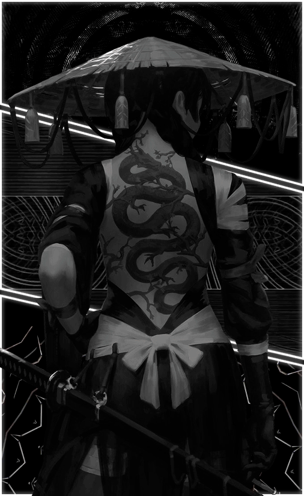
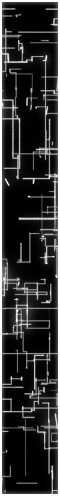
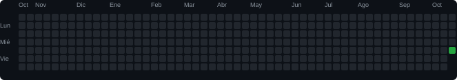
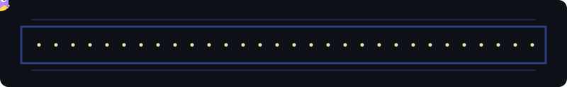

<table>
<tr>
<td width="56%" valign="top">

# Kevin Hernández 

**Ingeniería en Sistemas Computacionales**  
**Nacionalidad:**  

## About me

Soy **Kevin**, egresado de Ingeniería en Sistemas Computacionales. Me interesan los sistemas, el desarrollo de software y las bases de datos.

Aprendo rápido, soy amable y responsable, y disfruto resolver problemas y seguir creciendo profesionalmente.

También disfruto los videojuegos y crear soluciones útiles con tecnología.

</td>
<td width="44%" align="center" valign="top">

  

</td>
</tr>
</table>

##  Tech stack

<table>
<tr>
<th>Desarrollo</th>
<th>Bases de datos</th>
<th>Herramientas</th>
</tr>
<tr>
<td align="center"></td>
<td align="center"></td>
<td align="center"></td>
</tr>
</table>

<table>
<tr><th>Web y backend</th><th>Pruebas y componentes</th><th>Más herramientas</th></tr>
<tr>
<td align="center">   </td>
<td align="center"> </td>
<td align="center">   </td>
</tr>
</table>

##  GitHub activity

<table>
<tr>
<td width="50%" align="center"></td>
<td width="50%" align="center"></td>
</tr>
</table>

### Días de actividad

## 👾 Arcade

## 🌐 Redes y contacto

        

