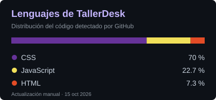
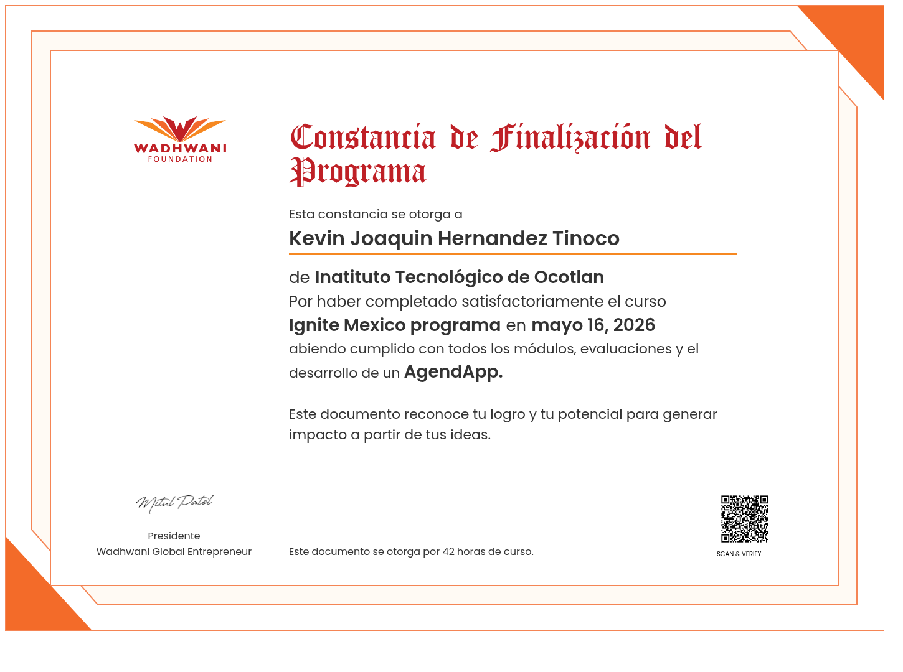
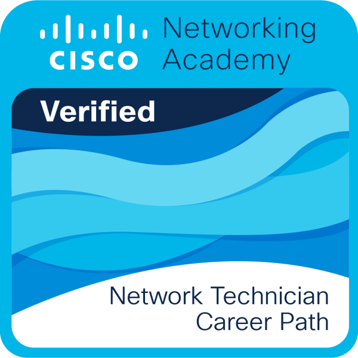
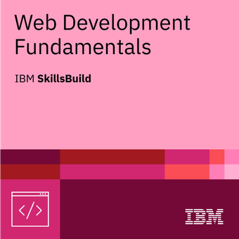
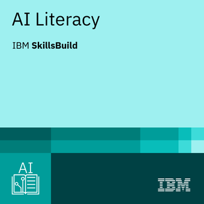
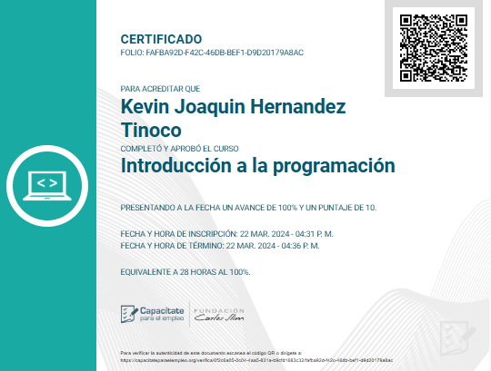

<table>
<tr>
<td width="56%" valign="top">

# Kevin Hernández 

  
<strong>Nacionalidad:</strong>  

  

## About me

Soy **Kevin**, egresado de:

Me interesan los sistemas, el desarrollo de software y las bases de datos.

Aprendo rápido, soy amable y responsable, y disfruto resolver problemas y seguir creciendo profesionalmente.

También disfruto los videojuegos y crear soluciones útiles con tecnología.

</td>
<td width="44%" align="center" valign="top">
<picture><source srcset="assets/steam-art.gif" /></picture><picture><source srcset="assets/steam-side.gif" /></picture>
  

</td>
</tr>
</table>

##  Tech stack

<table>
<tr><th>Desarrollo</th><th>Bases de datos</th><th>Herramientas</th></tr>
<tr>
<td align="center"></td>
<td align="center"></td>
<td align="center"> </td>
</tr>
</table>

##  GitHub activity

<picture>
  <source media="(prefers-color-scheme: dark)" srcset="https://raw.githubusercontent.com/Kevenchingas/Kevenchingas/pacman-output/pacman-contribution-graph-dark.svg?game=pacman">
  <source media="(prefers-color-scheme: light)" srcset="https://raw.githubusercontent.com/Kevenchingas/Kevenchingas/pacman-output/pacman-contribution-graph.svg?game=pacman">
  
</picture>

## 🎓 Mis cursos

<table>
<tr>
<td width="33%" height="160" align="center" valign="middle"></td>
<td width="33%" height="160" align="center" valign="middle"></td>
<td width="33%" height="160" align="center" valign="middle"></td>
</tr>
<tr>
<td width="33%" height="70" align="center" valign="middle"><strong>Ignite México</strong> Wadhwani Foundation · 42 horas</td>
<td width="33%" height="70" align="center" valign="middle"><strong>Network Technician Career Path</strong> Cisco Networking Academy</td>
<td width="33%" height="70" align="center" valign="middle"><strong>Web Development Fundamentals</strong> IBM SkillsBuild</td>
</tr>
<tr>
<td width="33%" align="center"></td>
<td width="33%" align="center"></td>
<td width="33%" align="center"></td>
</tr>
<tr>
<td width="33%" height="160" align="center" valign="middle"></td>
<td width="33%" height="160" align="center" valign="middle"></td>
</tr>
<tr>
<td width="33%" height="70" align="center" valign="middle"><strong>AI Literacy</strong> IBM SkillsBuild</td>
<td width="33%" height="70" align="center" valign="middle"><strong>Introducción a la programación</strong> Capacítate para el Empleo · 28 horas</td>
</tr>
<tr>
<td width="33%" align="center"></td>
<td width="33%" align="center"></td>
</tr>
</table>

## 🌐 Redes y contacto

