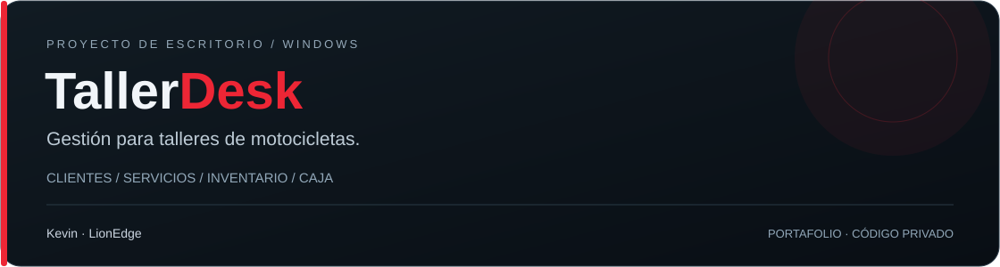

# TallerDesk

**Aplicación de escritorio para administrar talleres de motocicletas.**

Proyecto desarrollado por **Kevin · LionEdge**, centrado en organizar el trabajo del taller: desde la recepción de una moto hasta el cobro y la consulta de sus movimientos.

## Qué permite hacer

| Área | Funciones |
|---|---|
| Clientes | Registro, edición, búsqueda e identificación de clientes y sus motocicletas. |
| Servicios | Registro y seguimiento de trabajos, estados y cobros. |
| Inventario | Productos, existencias y ventas. |
| Caja | Apertura y cierre de cortes, movimientos e ingresos por fecha. |
| Estadísticas | Gráfica semanal y comparación de ingresos entre dos días. |
| Configuración | Colores de acento, tamaño de texto y estado de sincronización. |

## Decisiones de desarrollo

- **Escritorio con Electron:** distribución mediante instalador para Windows de 64 bits.
- **Interfaz con JavaScript, HTML y CSS:** tema oscuro, tablas de trabajo y gráficas SVG.
- **Firebase Authentication y Cloud Firestore:** acceso por cuenta y organización de la información del taller.
- **Operaciones locales con IndexedDB:** cola persistente y envío al recuperar conexión; incluye controles para reintentos y conflictos.
- **Git y npm:** historial de cambios, compilación y pruebas locales.

## Estado del proyecto

Versión de escritorio **1.0.0**. El instalador se ha generado y se han ejecutado pruebas locales de operaciones sin conexión y sincronización simulada. La comprobación de sincronización con datos reales y la instalación en cada equipo de destino son pruebas adicionales.

## Presentación pública

Esta ficha muestra el proyecto y las tecnologías utilizadas. **El código fuente, la configuración interna y los datos de los talleres no se publican aquí.** El instalador tampoco se ofrece como descarga pública en esta ficha.

Las etiquetas de tecnologías son descriptivas; no representan porcentajes automáticos de lenguajes calculados por GitHub.

## Contacto

Para solicitar información o una demostración, visita [mi perfil de GitHub](https://github.com/Kevenchingas).

[← Volver a mi perfil](https://github.com/Kevenchingas)
